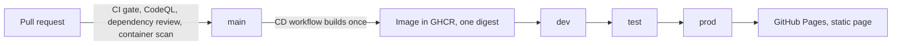

# GitHub CI/CD showcase

A deliberately small Express 5 and TypeScript widgets service that exists to demonstrate a
GitHub CI/CD pipeline. The service is simple on purpose; the pipeline around it is the point.

> [!WARNING]
> **This is a demonstration repository, and it is vulnerable on purpose.** It contains intentional
> vulnerabilities and deliberately outdated dependencies, listed under
> [Intentional findings](#intentional-findings). A repository created from this template copies them.
> Do not deploy it anywhere real, and do not copy `src/insecure-demo.ts` or the pinned `morgan` and
> `requests` versions into a real project. See [SECURITY.md](SECURITY.md).

To present it, follow the click-through runbook in [DEMO.md](DEMO.md). [SPEC.md](SPEC.md) holds the
design and the acceptance criteria.

## Using this repository as a template

A repository created from this template gets the files and nothing else. GitHub does not copy
repository settings, so set these up in your copy before you run the demo:

1. **CODEOWNERS.** Replace `@johnhain-msft` in `CODEOWNERS` with your own user or team.
2. **Security features.** In Settings, then Advanced Security, turn on the dependency graph,
   Dependabot alerts, secret scanning and push protection. Leave CodeQL on advanced setup so that
   `codeql.yml` runs.
3. **Environments.** Create `dev` (no rules), `test` (a 5-minute wait timer, deployments from `main`
   only) and `prod` (a required reviewer, deployments from `main` only). [DEMO.md](DEMO.md) lists the
   exact settings.
4. **GitHub Pages.** Set the Pages source to GitHub Actions.
5. **Ruleset.** Import `.github/rulesets/main-protection.json` under Settings, then Rules, then
   Rulesets. Push `main` and let CI run once first, so the required checks exist when you import it.

The CD workflow publishes the image to your own GitHub Container Registry namespace, so the first
run creates a new package. Nothing is shared with this repository.

## What this repository demonstrates

- **One definition of "it works".** `npm run gate` runs lint, type checking, unit tests, Python lint
  and tests, a workflow validator and a deployment self-test. CI runs the same command.
- **Layered security scanning.** CodeQL for TypeScript and Python, dependency review and a Trivy scan
  of the container image on every pull request, Dependabot for four ecosystems, and OpenSSF
  Scorecard once a week.
- **Build once, deploy the same digest three times.** The CD workflow builds the image one time,
  publishes it to GitHub Container Registry with an SBOM and a build-provenance attestation, and
  deploys that one digest to dev, test and prod. No environment builds anything.
- **Environment protection and rollback.** Wait timers, required reviewers and branch restrictions
  are environment settings in GitHub, listed in [DEMO.md](DEMO.md). A separate workflow redeploys any
  earlier digest to any environment.
- **Governance as files.** A ruleset for `main`, CODEOWNERS, issue forms, a pull request template, a
  security policy and contributing guidelines.
- **Secret scanning with push protection.** Nothing is committed for this one. The demo types a
  synthetic value at the terminal instead; see [DEMO.md](DEMO.md).

## Architecture



| Path | What it holds |
|---|---|
| `src/` | The service: `app.ts` (the Express app), `server.ts` (HTTP wiring and listen), `widgets.ts` (in-memory store and validation), `config.ts` (environment variables), `logger.ts`, and `insecure-demo.ts` (the deliberately vulnerable demo routes) |
| `public/` | The static page the service serves at `/` and the CD workflow publishes to GitHub Pages |
| `tools/` | `report.py`, a small Python script that summarizes a deployment record. It gives the repository a second language and a second Dependabot ecosystem |
| `scripts/` | The gate, setup, the workflow validator, the mocked deployment and the smoke test |
| `test/` | The Vitest tests for the service |
| `.github/` | Workflows, Dependabot configuration, the ruleset, issue forms and the pull request template |

The service keeps its widgets in memory, so a restart starts empty.

| Request | Response |
|---|---|
| `GET /` | The static page |
| `GET /healthz` | `200 {"status":"ok","uptimeSeconds":...}` |
| `GET /api/version` | `{"version":...,"commit":...,"environment":...}` |
| `GET /api/widgets` | `{"items":[...]}` |
| `GET /api/widgets/:id` | The widget, or `404 {"error":"not_found"}` |
| `POST /api/widgets` | `201` with the new widget, or `400 {"error":"invalid_payload","details":[...]}` |
| `DELETE /api/widgets/:id` | `204`, or `404 {"error":"not_found"}` |
| anything else | `404 {"error":"not_found"}` |

## Quick start

Requires Node.js 24 or newer and Python 3. Docker is needed only to build and run the container
image.

```sh
npm run setup      # install Node dependencies and create .venv with the Python dev tooling
npm run gate       # run every leg of the acceptance gate
npm run gate:test  # run the gate's own tests
```

There is no `npm start` script. The service runs from its container image: the Dockerfile compiles
the TypeScript and starts `node dist/server.js`. To run it:

```sh
docker build -t showcase:dev .
docker run -p 3000:3000 showcase:dev
curl http://localhost:3000/healthz
```

`GET /healthz` answers `200 {"status":"ok","uptimeSeconds":...}`. The image is multi-stage, runs
as the unprivileged `node` user, pins its base image by digest and carries production
dependencies only. To stamp the values reported by `GET /api/version`, pass
`--build-arg APP_VERSION=...` and `--build-arg GIT_COMMIT=...` to `docker build`.

## The gate

`npm run gate` is the single definition of "it works". It runs seven legs in order, keeps going when
one fails so that one run shows everything, prints a line for each, and exits non-zero if any leg
failed.

| Leg | What it checks | What it runs |
|---|---|---|
| `lint` | ESLint over the repository | `eslint .` |
| `typecheck` | TypeScript in strict mode, without emitting files | `tsc --noEmit` |
| `test` | The Vitest suite | `vitest run` |
| `py-lint` | Ruff over `tools/` | `python -m ruff check tools` |
| `py-test` | pytest over `tools/` | `python -m pytest tools -q` |
| `workflows` | Every file in `.github/workflows`: valid YAML, actions pinned to a full commit SHA with a version comment, a top-level `permissions:` block, no `write-all`, environments limited to dev, test and prod | `node scripts/validate-workflows.mjs` |
| `deploy` | The mocked deployment as a self-test: one digest goes through dev, test and prod with `--mock` (no container) on throwaway ports, each is smoke tested and each record is checked | `node scripts/deploy.mjs --self-test` |

A leg ends in one of three states:

- **PASS**: it ran and exited 0.
- **FAIL**: it ran and failed, or the tool it needs is not installed. `npm run setup` fixes the second case.
- **SKIP**: the file the leg checks does not exist, so there is nothing to check. A skip never fails the gate.

`npm run gate:list` shows the legs and whether each one has something to check. The gate calls each
tool itself rather than through an npm script, so editing `package.json` cannot change what it
measures. Building the image is not a leg; the `Docker build` job in CI covers that.
`npm run gate:test` runs the gate's own tests.

## The pipeline

| Workflow | Runs on | What it does |
|---|---|---|
| `ci.yml` (CI) | Pull requests, pushes to `main` | Installs dependencies, runs `npm run gate` and `npm run gate:test`, then builds the image |
| `codeql.yml` (CodeQL) | Pull requests, pushes to `main`, weekly | CodeQL for JavaScript/TypeScript and Python with the `security-extended` queries |
| `dependency-review.yml` | Pull requests | Reviews the dependency changes in the pull request and fails on high or critical advisories |
| `container-scan.yml` | Pull requests, weekly | Builds the image, scans it with Trivy and uploads the results to code scanning. Informational: it does not fail the run |
| `scorecard.yml` | Weekly, manual | OpenSSF Scorecard supply-chain checks |
| `cd.yml` (CD) | Pushes to `main`, manual | Builds the image once, publishes it to GHCR with an SBOM and a build-provenance attestation, deploys that digest to dev, then test, then prod, and publishes the static page to GitHub Pages from prod |
| `rollback.yml` | Manual | Redeploys a digest you supply to the environment you choose |

Dependabot (`.github/dependabot.yml`) checks npm, pip, Docker and GitHub Actions weekly and groups
minor and patch updates into one pull request per ecosystem.

## What "deploy" means here

There is no cloud behind this repository: the deployments are mocked on purpose. In `cd.yml` the
`build` job builds the image once and publishes it to GitHub Container Registry, tagged with the
commit SHA. Each deploy job then runs `scripts/deploy.mjs` with that image's `sha256:` digest, and
the script refuses anything that is not pinned by digest. It runs the image on the GitHub Actions
runner with that environment's settings, waits for `GET /healthz`, checks that `GET /api/version`
reports the environment it was asked for, and writes a record to `.deploy/<env>.json`. The smoke
test then checks the HTTP contract, and the job uploads the record as the artifact
`deploy-record-<env>`. When the job ends the runner goes away, and the container with it.

What is real: one image build, one digest handed unchanged to dev, test and prod, and the
environment protection rules that gate each deploy job. What is not: a running service you can visit.

`rollback.yml` works the same way in reverse. You choose an environment and supply a digest from an
earlier run, and it runs the same deployment of that digest, without the smoke test, and uploads a
`rollback-record-<env>` artifact. The rollback job names the same environment, so that environment's
protection rules apply to it.

The `deploy-prod` job also publishes the contents of `public/` to GitHub Pages. That is the static
page only: its requests to `/api/version` and `/api/widgets` have no service to answer them there.
The repository's Pages source has to be set to GitHub Actions first (see [DEMO.md](DEMO.md)). A Pages
site is public on the internet, including one published from a private repository, unless the
organization's plan supports private publishing.

## Configuration

The service reads these environment variables. An unset variable takes its default. A variable set
to an invalid value also takes its default and logs one warning, so bad configuration does not stop
the service from starting.

| Variable | Default | Meaning |
|---|---|---|
| `PORT` | `3000` | Port to listen on, 0 to 65535 |
| `APP_ENV` | `local` | Environment name that `GET /api/version` reports |
| `APP_VERSION` | `0.0.0-dev` | Version that `GET /api/version` reports |
| `GIT_COMMIT` | `unknown` | Commit that `GET /api/version` reports |
| `LOG_LEVEL` | `info` | `debug`, `info`, `warn` or `error` |
| `ENABLE_INSECURE_DEMO` | `false` | Serves the vulnerable demo routes only when set to exactly `true` |

## The vulnerable demo routes

`src/insecure-demo.ts` holds the two planted code vulnerabilities, served under `/demo`. They are off
unless `ENABLE_INSECURE_DEMO` is exactly `true`. With the variable unset, or set to anything else
(`TRUE`, `1` and `yes` included), `/demo/*` answers `404 {"error":"not_found"}` like any other
unknown path. The Dockerfile does not set the variable and `scripts/deploy.mjs` forces it to
`false` in every environment it deploys, so nothing in the pipeline serves these routes.

To see them respond, run a container on your own machine and publish the port on the loopback
interface only:

```sh
docker run -p 127.0.0.1:3000:3000 -e ENABLE_INSECURE_DEMO=true showcase:dev
curl "http://127.0.0.1:3000/demo"
curl "http://127.0.0.1:3000/demo/echo?text=hello"
curl "http://127.0.0.1:3000/demo/validate?title=Hello"
```

They answer with a list of the demo routes, `{"output":"hello"}` and `{"valid":true}`. Never run a
container like this where anyone else can reach it: `/demo/echo` runs commands inside the
container, and `/demo/validate` can keep the server busy for as long as a caller likes.

## Intentional findings

This repository ships with deliberate findings so that GitHub's scanners have something real to
report. They are not oversights and they are not bugs, so please do not fix them in a drive-by
change (see [CONTRIBUTING.md](CONTRIBUTING.md)). This table lists every item planted on purpose.

| Item | Where | What it triggers | Why it is here |
|---|---|---|---|
| `morgan@1.10.1`, three advisories | `package.json`; mounted in `src/app.ts` | Dependabot alerts (npm), and the Trivy image scan | A published advisory on a package the service imports and runs, so the finding is reachable and not merely declared |
| `requests==2.31.0`, three advisories | `tools/requirements.txt`; imported by `fetch()` in `tools/report.py` | Dependabot alerts (pip) | The same, for a second ecosystem |
| Command injection (CWE-78) | `src/insecure-demo.ts`, `GET /demo/echo` | CodeQL `js/command-line-injection`, titled "Uncontrolled command line" | A traceable path from request input to a shell command, which code scanning shows as a code flow and Copilot Autofix can try to fix |
| Regular-expression denial of service (CWE-1333) | `src/insecure-demo.ts`, `GET /demo/validate` | CodeQL `js/redos`, titled "Inefficient regular expression" | A second class of CodeQL finding, so the demo shows more than injection |

Both dependencies are imported by shipped code, and both code vulnerabilities are statically
reachable from exported route handlers, so every finding is reachable and not merely declared.

### npm: `morgan@1.10.1`

Pinned exactly in `package.json` and mounted in `src/app.ts`, where it writes the access log
entry for every request.

- [GHSA-4vj7-5mj6-jm8m](https://github.com/advisories/GHSA-4vj7-5mj6-jm8m): log forging through
  unneutralized control characters in `:remote-user` (fixed in 1.11.0)
- [GHSA-jxfw-x594-9x9m](https://github.com/advisories/GHSA-jxfw-x594-9x9m): log forging through
  unescaped Unicode line separators (fixed in 1.12.0)
- [GHSA-9f6g-j8ch-79g4](https://github.com/advisories/GHSA-9f6g-j8ch-79g4): log injection through
  an unescaped double quote in quoted log fields (fixed in 1.12.1)

Upgrading to 1.12.1 or later clears all three.

### pip: `requests==2.31.0`

Pinned in `tools/requirements.txt` and imported by `fetch()` in `tools/report.py`, which
`report.py` calls when it is given an `http://` or `https://` URL instead of a file path.

- [GHSA-9wx4-h78v-vm56](https://github.com/advisories/GHSA-9wx4-h78v-vm56): a `Session` stops
  verifying certificates after its first request made with `verify=False` (fixed in 2.32.0)
- [GHSA-9hjg-9r4m-mvj7](https://github.com/advisories/GHSA-9hjg-9r4m-mvj7): `.netrc` credentials
  can leak through malicious URLs (fixed in 2.32.4)
- [GHSA-gc5v-m9x4-r6x2](https://github.com/advisories/GHSA-gc5v-m9x4-r6x2): insecure temporary
  file reuse in `extract_zipped_paths()` (fixed in 2.33.0)

Upgrading to 2.33.0 or later clears all three.

`npm run setup` installs only the Python dev tooling, so to point `tools/report.py` at a URL,
install the runtime pin into `.venv` first:
`.venv/bin/python -m pip install -r tools/requirements.txt` (`.venv\Scripts\python` on Windows).

All six advisories are rated medium in the GitHub Advisory Database.

### Code: `src/insecure-demo.ts`

Two exported route handlers, registered on an exported Express router that `src/app.ts` mounts at
`/demo` only when `ENABLE_INSECURE_DEMO` is `true`. Each vulnerable line carries a `VULNERABLE:`
comment naming its class.

- **Command injection (CWE-78).** `GET /demo/echo?text=...` concatenates the `text` query parameter
  into a command line that it passes to `child_process.exec`, so a shell parses it. The fix is to
  not use a shell: call `execFile` with an argument array, or do not shell out for an echo at all.
- **ReDoS (CWE-1333).** `GET /demo/validate?title=...` tests the `title` query parameter against
  `/^(\w+\s?)+$/`. The nested quantifiers make a failing match backtrack exponentially in the length
  of the input. The fix is a pattern without nested quantifiers, plus a length limit.

The code is reachable on purpose. CodeQL reports a vulnerability only when request input can be traced
to it, so moving either flaw behind a dead branch, or out of the exports, would make its alert
disappear.

### What else you will see, and what you will not

- **More than two code-scanning alerts.** CodeQL also reports `js/missing-rate-limiting` ("Missing
  rate limiting") on the route that runs the shell command. That is a by-product of the planted
  code and not a third planted item: rate limiting is out of scope for this service. Trivy results
  are uploaded to the same code scanning page, and other alerts can appear in other files, so treat
  the table above, not the alert count, as the list of what was planted.
- **No dependency review failure.** It looks only at the dependency changes in a pull request, and it
  fails only for high or critical advisories. Both planted advisories are medium and already on
  `main`.
- **No Dependabot pull request for these two packages.** `.github/dependabot.yml` ignores `morgan`
  and `requests` so that an update does not replace the finding. The ignore entries suppress both
  version-update and security-update pull requests; Dependabot alerts are unaffected.
- **No secret in the repository.** The push-protection demo types a synthetic value at the terminal.
  [DEMO.md](DEMO.md) explains how to prepare one, and the value is never written to a tracked file.

### How the code findings were checked

Both CodeQL findings were reproduced with the CodeQL CLI (2.27.2) on a copy of this source tree, using
the `security-extended` suite that `codeql.yml` selects: `js/command-line-injection` at the `exec`
call and `js/redos` at the pattern. The same run reported the by-product alert described above. The
advisories for `morgan` and `requests` come from the GitHub Advisory Database.

## License

MIT. See [LICENSE](LICENSE).
